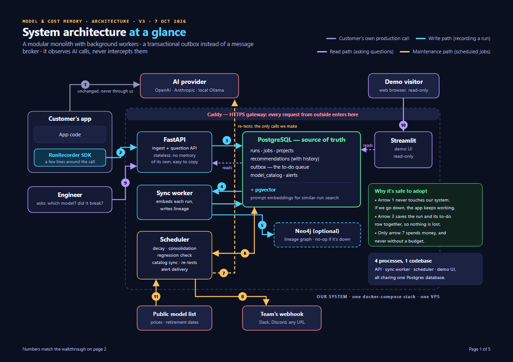

# Architecture

A **modular monolith with background workers**: one Python codebase, run as three processes plus a static web app that
share one PostgreSQL database and talk through a **transactional outbox** instead of a message
broker. The system **observes AI calls and never intercepts them**.

The illustrated version, with a walkthrough and glossary, is
[`Architecture_Overview.pdf`](Architecture_Overview.pdf).



## What each numbered arrow means

| # | Path | What happens |
|---|---|---|
| 1 | Production | The customer's app calls the AI provider exactly as before. We are never in this path |
| 2 | Write | `RunRecorder` sends a copy of the run (prompt, model, exact version, tokens, cost, latency, output) to `POST /v1/runs` in the background, adding under 5 ms |
| 3 | Write | The API checks pass/fail, then saves the run **and** an outbox row in one transaction and replies `202` |
| 4 | Write | The sync worker claims outbox rows with `SELECT … FOR UPDATE SKIP LOCKED` |
| 5 | Write | It embeds each prompt and stores the embedding in pgvector |
| 6 | Maintenance | Decay, consolidation and the regression check run on the stored runs |
| 7 | Maintenance | Re-tests replay sampled runs on new or candidate models: the only calls we make, always under a budget |
| 8 | Maintenance | Regression alerts are pushed to the project's webhook |
| 9 | Read | The engineer asks: which model, did it break, why did it change, what does each job cost |
| 10 | Read | People use the web app (Google sign-in; a user sees only their own projects). Visitors cannot spend the budget |
| 11 | Maintenance | Catalog sync reads a public model list daily for prices and retirement dates |

## Three independent paths

| Path | Trigger | Steps |
|---|---|---|
| **Write** | Every model call | Validate → pass/fail check (answer key, tests in a sandbox, or schema) → run + outbox row in one transaction → `202` → worker indexes it |
| **Read** | Someone asks | Load checked runs → weight by freshness → group by model, drop retired models → evidence floor → 95% intervals → tolerance rule → lowest cost per success → verdict with failing runs and a savings forecast. The per-model sums are one Postgres pass in hour buckets, not one Python object per run. Cached for 5 minutes against a fingerprint of the runs; a job slower than 250 ms to compute gets its last verdict (at most a minute old) while the new one is computed in the background. Never writes |
| **Maintenance** | Scheduler | Decay (hourly) · consolidation and regression sweep (every 15 min) · re-tests (every 30 s, queued) · alert delivery (every minute) · catalog sync (daily) |

They share only the database, so a slow re-test never slows recording and a burst of runs never
slows answers. Each process keeps a small connection pool (`DB_POOL_SIZE` 3 + `DB_MAX_OVERFLOW` 2), and only one
scheduler runs jobs at a time: it holds a Postgres advisory lock for its lifetime, and a second one waits as a
standby, so a re-test can never be started twice.

**Life of a run:** `CAPTURED → CHECKED → INDEXED → CONSOLIDATED → ARCHIVED` (failure:
`INGESTION_FAILED`). Archived runs are never deleted; they stop counting.

## Core formulas

```
freshness            R(t) = e^(-t / S),  S = importance × 30 × version_factor
                     version_factor = 1.00 current, 0.25 superseded (fades ~4× faster)
weighted pass rate   Σ(R × passed) / Σ R, with S = 30 × version_factor (importance decides archiving
                     and re-test sampling, never the average: an outcome-dependent weight biases it)
cost per run         usage × catalog price (input, output incl. thinking, cache read, cache write)
cost per success     mean cost / weighted pass rate
pass-rate interval   Wilson 95%, over the Kish effective sample size (Σ R)² / Σ R²
tolerance rule       a model is GOOD_ENOUGH when we are 95% sure it is at most 3 points worse
                     than the best (Newcombe interval of the difference), CLEARLY_WORSE when sure
                     it is more, UNSURE otherwise (a re-test settles it)
recommendation       lowest cost per success among GOOD_ENOUGH models, never RETIRED;
                     INSUFFICIENT_EVIDENCE until a model reaches the evidence floor. A DOWNGRADE also
                     needs the pick shown within 3 points of the model in use, not only of the best;
                     otherwise HOLD and re-test it. A model in use that measures more than 3 points
                     behind the best, unproven, gets the best model re-tested to settle it
savings forecast     saving = (cost per success now − recommended) × successes per month;
                     extra failures = (pass rate now − recommended) × runs per month, with its interval
regression           one-sided two-proportion z-test, the current version against the one it replaced:
                     p < boundary AND drop ≥ 3 points AND ≥ 30 runs a side. The sweep checks daily,
                     so the boundary is strict early (z ≥ z₀.₀₀₅ × √(500 / n), but never past
                     p < 0.0001) and p < 0.005 from 500 runs on the new version
silent drop          same version, last 28 days (≥ 20 with runs) split in half: p < 0.001 AND drop ≥ 3
                     points, plus a standardized one-sided CUSUM over the second half (k = 0.5, h = 4)
re-test spend        before every call: re-test spend + reserved + this call ≤ budget, and this month's
                     project re-test spend (at list price) + reserved + this call ≤ the monthly cap
```

Measured on the simulated-time harness (`scripts/simulate.py`, 50 trials each, 50 runs a day):
version regressions of 5 points caught 48/50 and of 10 and 15 points 50/50, a 10-point one the day after
the upgrade, with 1 false alarm in 50 controls; silent drops of 5 points caught 34/50, of 10 and 15 points
50/50, with no false alarms. The earlier rule (a fixed p < 0.05 checked daily, 5-point minimum) looked
alarm-free over 20 trials, but over 20,000 simulated ones it raised a false alarm on 7% of unchanged
upgrades. Results in `reports/`.

The held-out check (`scripts/holdout_check.py`, `reports/holdout_check.md`) scores the engine's pick on
prompts it never saw. It found that with little evidence the luckiest model could be recommended without
being compared with the model in use (8% of picks at 25 runs were more than 3 points worse than the best),
which is why a DOWNGRADE now needs that comparison.

## Five design decisions

| Decision | Why |
|---|---|
| **Observe, never intercept** | If this system goes down, the customer's app keeps working |
| **Modular monolith** | One codebase, clear modules, three processes and a static web app. Microservices are overkill for this scale |
| **Transactional outbox, no broker** | Nothing is lost or processed twice, with no Kafka/RabbitMQ to run. The database is the queue |
| **Three independent paths** | Each can be slow or fail without dragging the others down |
| **Swappable storage** | `VectorStoreClient` interface (pgvector now, Chroma as a fallback) |

## Data model

The authoritative schema is [`db/schema.sql`](../db/schema.sql): `users`, `projects`, `provider_keys`,
`jobs`, `retests`, `runs`, `recommendations`, `outbox`, `model_catalog`, `model_prices`, `alerts`, `flow_events`.

- `recommendations.consolidated_from` links a conclusion to every run behind it.
- `recommendations.superseded_by_id` links it to the conclusion that replaced it, with a date and
  reason, so history is never overwritten.
- `runs.model_version` is the provider-resolved snapshot; decay and regression tests key on it.
- `runs.run_id` is generated by the SDK, so a retried send hits the same row and never double-counts.
- `runs.embedding` (a pgvector column with an HNSW index) holds the prompt embedding the sync worker writes.
- `runs.embedding_model` records which embedder wrote each vector. Vectors from different embedders are never
  compared or reused, and a stored vector is reused for the same prompt in the same project, so a prompt is
  never embedded twice, even across restarts.
- `projects.store_tool_arguments` (off by default) decides whether tool-call arguments are kept. By default only
  each tool's name and call id are stored; the SDK and the server both enforce it.
- `runs.outcome` and `runs.outcome_reason` are resolved by the job's checker, never supplied by the client.
- `model_catalog` has one row per model name; `model_prices` has each provider's own price for it, because the
  same open-weight model is sold by several providers at different prices. A run that names its `provider` is
  priced from `model_prices`; one that does not, from the catalog. A hand-entered (MANUAL) catalog price wins.
- Providers also retire the same model on different dates (Vertex AI retired gemini-2.5-flash on 20 Oct 2026; the
  Gemini API still serves it), so `model_prices` keeps each provider's shutdown date and a job's model status is
  read for the provider its runs name (`catalog/lifecycle.py`). Without a provider, a model one provider retired
  but others still serve is DEPRECATED with a note, never RETIRED.
- `runs.cost_usd` is NULL when the model has no catalog price and the client sent none: unknown, never "free".
  Costs are averaged over priced runs only, and spend reports how many runs it could not price.
- `runs.embedding_model` names the embedder with its pinned weights (`minilm@<revision>`), so upgrading the model
  never reuses vectors from the old one.
- `runs.expected` keeps an answer key only when the job has re-test consent, because a replayed run can only be
  checked against the same answers. Otherwise the answers are used for the check and dropped.
- `recommendations.current_model` records what production used when a verdict was made, so history can say what
  was recommended instead of what.
- `alerts.dedupe_key` (one open alert per finding) and `delivery_attempts` / `next_attempt_at` (webhook retries with
  backoff). Payloads are signed with `projects.webhook_secret` (HMAC-SHA256, header `X-MCM-Signature`) and carry a
  one-line `text`/`content` message, so a Slack, Discord, Google Chat or Mattermost incoming webhook works directly.
- `retests` records each replay: trigger (`MANUAL`, `NEW_MODEL`, `UNSURE`), budget, spend, progress and why it
  stopped. `provider_keys` holds the customer's key for re-tests, encrypted with the server's `SECRET_KEY`; only the
  last four characters are ever shown.
- `users` and `projects.owner_user_id`: Google sign-in; a signed-in user sees only their own projects.
- `flow_events` is the live data-flow view's trail (`sdk → api → check → index → consolidate`), written in the same
  transaction as each step and deleted after a day.
- The schema changes only through Alembic migrations (`migrations/versions/`). `db/schema.sql` is the reference
  snapshot, and a test fails if it disagrees with the migrations or the models.

## API

Every `/v1` route acts on one project and only sees that project's data: the one whose key is sent
(`X-API-Key: <key>` or `Authorization: Bearer <key>`: the SDK and scripts), or, for a signed-in user, the one
they own named in `X-Project-Id`. If `DEMO_PROJECT_ID` is set, anyone may read that one project, never change it.
The machine-readable contract is [`contract/openapi.json`](../contract/openapi.json).

| Method | Path | Purpose | Built |
|---|---|---|---|
| `GET` | `/healthz` | Liveness and database check (no key) | W2 |
| `GET` | `/v1/jobs` | Jobs with run counts, in total and per state | W2 |
| `POST` | `/v1/jobs` | Define a job and its success check | W3 |
| `GET` | `/v1/runs` | Recorded runs, newest first, filtered and paged; `?recommendation=` lists a verdict's runs | W2, W8 |
| `POST` | `/v1/runs` | Record a run (idempotent by `run_id`; answers 202) | W3 |
| `GET` | `/v1/runs/{id}` | One run in full, with why it passed or failed | W4 |
| `POST` | `/v1/runs/{id}/label` | Supply a late outcome label | W4 |
| `GET` | `/v1/models` | Model catalog: price, status and shutdown dates | W6 |
| `GET` | `/v1/jobs/{job}/recommendation` | Cheapest model that passes, with evidence, forecast and optional summary | W7, W8 |
| `GET` | `/v1/insights/spend` | Spend by job | W7 |
| `GET` | `/v1/jobs/{job}/history` | Every verdict, newest first: what changed, when and why (recursive SQL) | W8 |
| `GET` | `/v1/jobs/{job}/regressions` | The job's alerts (open by default) | W9 |
| `GET` | `/v1/alerts` | Every job's alerts in the project | W9 |
| `POST` | `/v1/alerts/{id}/resolve` | Mark an alert handled | W9 |
| `POST` | `/v1/jobs/{job}/retest` | Queue a re-test of a candidate, under a budget; 409 with a reason code when it cannot start | W10 |
| `GET` | `/v1/jobs/{job}/retest/{id}` | Re-test progress and spend so far (the page polls it every 2 s) | W10 |
| `GET` | `/v1/jobs/{job}/retests` | The job's re-tests | W10 |
| `GET` | `/v1/retest/limits` | Monthly cap, spend this month, and whether the provider key is given | W10 |
| `PUT` / `DELETE` | `/v1/provider-key` | Give or remove the key re-tests use (asked for when first needed) | W10 |
| `GET` | `/auth/config` | Which sign-in this server offers | W11 |
| `GET` | `/auth/google/login`, `/auth/google/callback` | Google sign-in; sets the session cookie | W11 |
| `POST` | `/auth/dev/login` | Development only (`DEV_LOGIN=true`): sign in by email | W11 |
| `POST` | `/auth/logout` | End the session | W11 |
| `GET` | `/v1/me` | The signed-in user | W11 |
| `GET` / `POST` | `/v1/projects` | The user's own projects; create one (its key is returned once) | W11 |
| `GET` / `PATCH` | `/v1/projects/{id}` | Name, alert webhook, monthly re-test cap, re-test switch | W11 |
| `POST` | `/v1/projects/{id}/key` | A new project key, shown once; the old one stops working | W11 |
| `GET` | `/v1/jobs/{job}/insights` | Cost per success per model; pass rate by input size and prompt version | W11 |
| `GET` | `/v1/flow` | The live data-flow trail, polled | W12 |
| `GET` | `/v1/flow/stream` | The same as Server-Sent Events (resumes from `Last-Event-ID`) | W12 |

## Repository layout

```
src/agent_memory/
├── config.py          env-driven settings, Neon/asyncpg URL handling
├── db.py              async engine and session factory
├── models.py          SQLAlchemy models (a test keeps them in step with the migrations)
├── schemas.py         request and response models: the API contract
├── security.py        project keys, webhook secrets, encryption of stored provider keys
├── logging_config.py  structured JSON logs carrying run_id, job_id and project_id
├── privacy.py         what is kept about a run: tool names and ids only, unless a project opts in
├── api.py             FastAPI routes (data); auth/routes.py adds sign-in and projects
├── ingest.py          write path: jobs, runs, outcomes, late labels (run + outbox row in one transaction)
├── projects.py        create a project and its key
├── costing.py         exact run cost from token usage and catalog prices
├── versions.py        model name normalisation (a model's family and its versions)
├── embeddings.py      MiniLM and hashing embedders behind an LRU cache
├── corpus.py          invoice-extraction corpus with exact known answers
├── recorder.py        RunRecorder SDK
├── scheduler.py       maintenance jobs: janitor, decay, consolidation, regression sweep, re-tests, alerts, catalog
├── checks/            OutcomeChecker interface; answer key, schema, late label (test command and sandbox: later)
├── storage/           vector_store (pgvector); lineage (recursive SQL over superseded_by_id)
├── pipeline/          sync_worker, janitor, scoring, decay, consolidation, regression, flow events
├── catalog/           model catalog: daily sync from the public price list, manual overrides
├── recommend/         stats (intervals, tolerance rule), engine, forecast, cache, optional summary
├── retest/            budgeted, importance-sampled replay: the only code that spends money
├── simulation/        simulated-time harness, regression evaluation, staleness experiment
├── auth/              Google sign-in, session cookie, project ownership, the public demo
├── insights/          spend and pass-rate breakdowns
├── alerts/            alert records, signed webhook delivery with backoff
└── prompts/           the one prompt file the system owns
migrations/            Alembic: the only way the schema changes (0001-0008)
contract/              OpenAPI file and sample responses the web app is built against
corpus/                the generated invoice corpus
deploy/                Caddy, backup, restore and deploy files for the server
frontend/              React web app: feature folders, shared data layer and components
reports/               measured results: regression detection, silent drops, the staleness experiment
scripts/               create_project, sync_catalog, build/run_corpus, simulate, staleness_experiment, seed_demo, ...
db/schema.sql · tests/ · docker-compose.yml · Dockerfile · pyproject.toml
```

## Technology

Python 3.11 · FastAPI · Pydantic v2 · PostgreSQL + SQLAlchemy 2 + Alembic · pgvector with local
`all-MiniLM-L6-v2` embeddings · scipy · APScheduler · cachetools · `cryptography` (provider keys) · `openai` client
for re-tests and demo data against any OpenAI-compatible endpoint (Gemini and Groq free tiers) · `anthropic` for the
optional summary (Claude Haiku) · React + Vite +
TypeScript web app (TanStack Query, React Router, Recharts) with Google sign-in via `authlib` ·
Neon (hosted PostgreSQL) for development, docker-compose on one VPS behind Caddy (HTTPS) for production.
